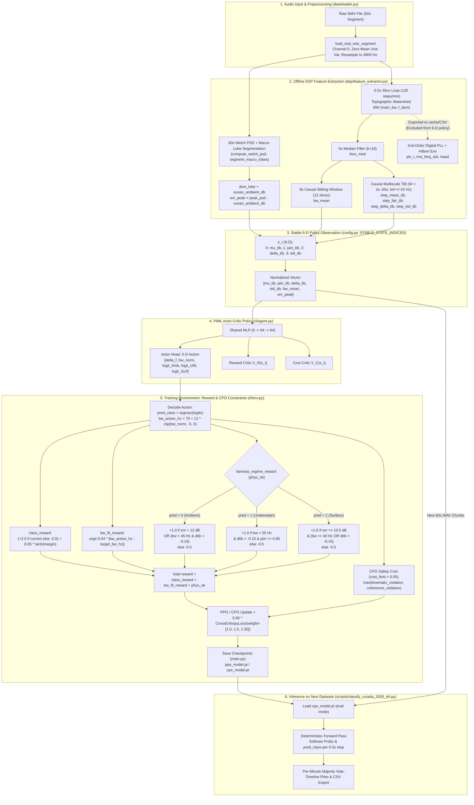
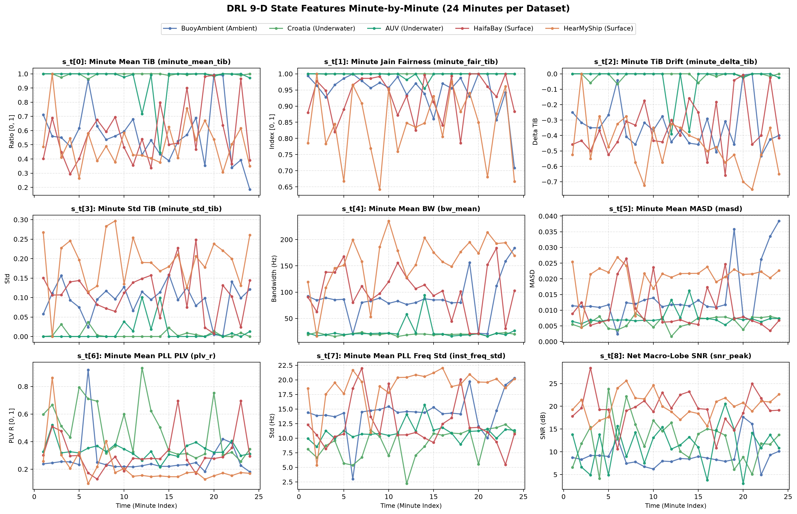
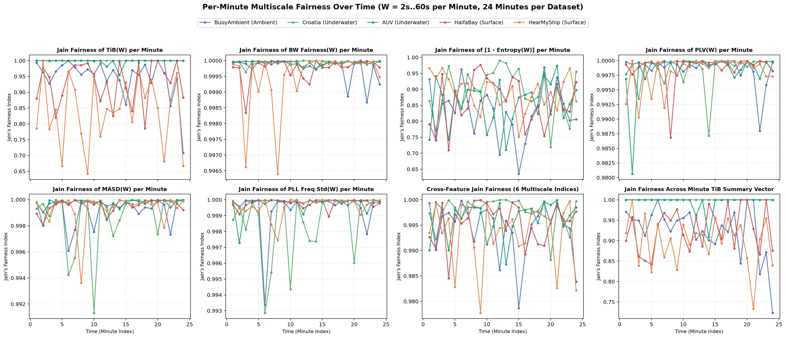

# Physics-Informed DRL Acoustic Detector: Architecture, Logic, and Evaluation Report

## 1. System Architecture & End-to-End Flow

The Physics-Informed Deep Reinforcement Learning (DRL) detector classifies underwater acoustic recordings into three physical regimes—**Ambient Ocean Noise (`0`)**, **Underwater Scooter / DPV (`1`)**, and **Surface Vessel (`2`)**—while simultaneously predicting a physical tracking bandwidth (`bw_action_hz`) and Doppler frequency shift (`delta_f`).

---

## 2. Component Breakdown

### 2.1 Audio Loading & Preprocessing ([`drl/data/loader.py`](file:///d:/dev/research/drl/data/loader.py#L30-L68))
* [`load_real_wav_segment`](file:///d:/dev/research/drl/data/loader.py#L30-L68) reads 60-second segments (channel `0` if multichannel), subtracts the mean, scales to unit variance, and resamples via `scipy.signal.resample_poly` to `target_fs = 4800.0` Hz.
* Datasets are split at the **file level** into 75% training (`18` minutes/dataset) and 25% held-out test (`6` minutes/dataset), plus BELLHOP synthetic episodes during training, and cached to [`extracted_features_cache.pkl`](file:///d:/dev/research/drl/output/extracted_features_cache.pkl).
* For `BuoyAmbient`, [`loader.py#L316-L324`](file:///d:/dev/research/drl/data/loader.py#L316-L324) separates passing surface vessels from calm ambient baseline (`21` `Ambient Noise` minutes and `3` `Surface Vessel` minutes in the current cache).

### 2.2 Offline DSP Feature Extraction ([`drl/dsp/feature_extractor.py`](file:///d:/dev/research/drl/dsp/feature_extractor.py#L292-L437))
1. **Macro-Lobe & SNR (`60` s)**: `compute_welch_psd` and `segment_macro_lobes` identify the dominant spectral lobe (`dom_lobe`) and ambient noise floor (`ocean_ambient_db`), yielding `snr_peak = peak_psd - ocean_ambient_db`.
2. **Instantaneous Bandwidth (`0.5` s slices)**: `compute_single_slice_watershed_bandwidth` tracks `main_bw` and `f_dom` every `0.5` s (`120` steps/minute). A 5-second median filter (`k = 10` slices) produces `bws_med`.
3. **Multiscale Time-in-Band (TiB) & Jain's Fairness**: Sweeps window scales $W \in \{2, 4, \dots, 60\}$ s in `2` s increments. Within each $W$-second block, TiB is the fraction of `bws_med` slices within $\pm 10$ Hz of the block median:
   * `step_mean_tib` ($\mu_{\text{TiB}}$): Mean TiB across scales $W$.
   * `step_std_tib` ($\sigma_{\text{TiB}}$): Standard deviation across scales $W$.
   * `step_delta_tib` ($\Delta\text{TiB}$): `TiB(W_end) - TiB(2s)`.
   * `step_fair_tib` ($J_{\text{TiB}}$): Jain's Fairness Index $J(x) = \frac{(\sum x_i)^2}{n \sum x_i^2}$ across the multiscale TiB curve.
4. **Digital PLL & Envelope (Exported, Excluded from Policy)**: `run_slice_digital_pll` and `compute_masd` compute `plv_r`, `inst_freq_std`, and `masd` per `0.5` s slice.

---

## 3. Stable 6-D Policy Observation Space

In [`drl/config.py`](file:///d:/dev/research/drl/config.py#L114-L124) and [`drl/rl/env.py`](file:///d:/dev/research/drl/rl/env.py#L36-L81), the policy observes only the **6 stable features** (`STABLE_STATE_INDICES = (0, 1, 2, 3, 4, 8)`):

| Index in `s_t` | Feature | Normalization | Role in Detection |
| :--- | :--- | :--- | :--- |
| `0` | Causal `mean_tib` | `(mu_tib - 0.78) * 4.5` | Separates steady Underwater (`~0.96–1.00`) from drifting Surface/Ambient (`~0.50–0.58`) |
| `1` | Causal `jain_tib` | `(jain_tib - 0.96) * 22.0` | Measures scale uniformity across `W = 2s..60s` |
| `2` | Causal `delta_tib` | `(delta_tib + 0.18) * 4.5` | Captures negative scale drift in cavitating/ambient signals |
| `3` | Causal `std_tib` | `(std_tib - 0.065) * 18.0` | Measures scale dispersion |
| `4` | 6 s Sliding `bw_mean` | `(bw_mean - 55.0) / 35.0` | Separates narrowband Underwater (`~20–27` Hz) from broadband Surface (`~102–163` Hz) |
| `8` | Recording `snr_peak` | `(snr_peak - 8.0) / 6.0` | Breaks the Ambient (`~9.1` dB) vs. Surface (`~19.5–20.2` dB) TiB overlap |

The noisy `0.5` s slice-level features (`5: masd`, `6: plv_r`, `7: inst_freq_std`) are omitted from the policy input because they fluctuate rapidly and overlap heavily across all five real datasets.

---

## 4. Reward Formulation & CPO Safety Constraints

In [`AcousticPIMLEnv.step()`](file:///d:/dev/research/drl/rl/env.py#L80-L165), the actor outputs a 5-D action `[delta_f, bw_norm, logit_Amb, logit_UW, logit_Surf]` and receives:

$$\text{reward} = \text{class\_reward} + \text{bw\_fit\_reward} + \text{fairness\_regime\_reward}$$

1. **`class_reward`**: `+2.0` if `pred_class == target_class` else `-2.0`, plus `0.65 * tanh(z_target - max_{j != target} z_j)`.
2. **`bw_fit_reward`**: `exp(-0.04 * |bw_action_hz - target_bw_hz|)`, where `bw_action_hz = 70.0 + 12.0 * clip(bw_norm, -5, 5)`.
3. **`fairness_regime_reward` (`phys_ok`, `+1.0` or `-0.5`)**:
   * **Ambient (`0`)**: `snr_peak < 12.0` dB OR (`bw_mean < 45.0` Hz and `delta_tib > -0.15`).
   * **Underwater (`1`)**: `bw_mean < 55.0` Hz AND `delta_tib > -0.15` AND `jain_tib >= 0.90`.
   * **Surface (`2`)**: `snr_peak >= 10.5` dB AND (`bw_mean >= 40.0` Hz OR `delta_tib < -0.15`).
4. **CPO Safety Cost (`cost_limit = 0.05`)**: `cost = max(kinematic_violation, coherence_violation)`, enforcing physical Doppler limits on `delta_f` and preventing extreme bandwidth/class contradictions.
5. **Auxiliary Classification Loss ([`rl/agent.py#L175-L191`](file:///d:/dev/research/drl/rl/agent.py#L175-L191))**: `0.60 * CrossEntropyLoss(weight=[1.0, 1.0, 1.35])` on `action[:, 2:5]`.

---

## 5. Observed Training, Held-Out Test, and `croatia-2026` Results

### 5.1 Disjoint Train vs. Held-Out Test Evaluation ([`drl/main.py`](file:///d:/dev/research/drl/main.py))

| Dataset | Policy | Train Acc | Test Acc | Test Cost | Test Reward | BW Gate | Target BW |
| :--- | :--- | :--- | :--- | :--- | :--- | :--- | :--- |
| **HaifaBay** | PIML-PPO | `87.5%` | `50.0%` | `0.000` | `+1.182` | `65.1 Hz` | `76.1 Hz` |
| **HaifaBay** | PIML-CPO | `86.4%` | `50.0%` | `0.000` | `+1.161` | `66.7 Hz` | `76.1 Hz` |
| **Croatia** | PIML-PPO | `100.0%` | `100.0%` | `0.000` | `+3.841` | `59.4 Hz` | `20.4 Hz` |
| **Croatia** | PIML-CPO | `100.0%` | `100.0%` | `0.000` | `+3.752` | `63.4 Hz` | `20.4 Hz` |
| **AUV** | PIML-PPO | `98.8%` | `71.8%` | `0.000` | `+2.049` | `63.5 Hz` | `27.5 Hz` |
| **AUV** | PIML-CPO | `90.6%` | `66.7%` | `0.000` | `+1.752` | `66.3 Hz` | `27.5 Hz` |
| **BuoyAmbient** | PIML-PPO | `92.9%` | `63.7%` | `0.000` | `+1.811` | `71.6 Hz` | `31.8 Hz` |
| **BuoyAmbient** | PIML-CPO | `94.4%` | `64.4%` | `0.000` | `+1.876` | `71.0 Hz` | `31.8 Hz` |
| **HearMyShip** | PIML-PPO | `90.7%` | `100.0%` | `0.000` | `+3.676` | `73.2 Hz` | `124.8 Hz` |
| **HearMyShip** | PIML-CPO | `92.8%` | `95.0%` | `0.000` | `+3.380` | `71.9 Hz` | `124.8 Hz` |

* **Per-Class Held-Out Test Accuracy**:
  * **Ambient Noise**: `95.6%` (PPO) | `96.7%` (CPO)
  * **Underwater Scooter**: `85.9%` (PPO) | `83.3%` (CPO)
  * **Surface Vessel**: `50.0%` (PPO) | `49.0%` (CPO)

### 5.2 Blind Inference on `croatia-2026` ([`classify_croatia_2026_drl.py`](file:///d:/dev/research/drl/scripts/classify_croatia_2026_drl.py))
Running the saved [`cpo_model.pt`](file:///d:/dev/research/drl/output/cpo_model.pt) checkpoint on `D:\RoyStudies\Recordings\croatia-2026` (output in [`croatia_2026_drl_predictions.csv`](file:///d:/dev/research/drl/output/croatia_2026_drl_detection/croatia_2026_drl_predictions.csv)):
* `audacity-scooter-round1.wav` (`34` mins): `34` Underwater Scooter
* `audacity-scooter-round2.wav` (`27` mins): `27` Underwater Scooter
* `audacity-scooter-round3.wav` (`11` mins): `10` Underwater Scooter, `1` Surface Vessel
* `audacity-vessel-round2.wav` (`11` mins): `11` Underwater Scooter
* `audacity-vessel-round3.wav` (`7` mins): `7` Underwater Scooter
* `audacity-vessels-round1.wav` (`11` mins): `1` Surface Vessel, `10` Underwater Scooter

---

## 6. Key Limitations & Recommended Next Improvements

1. **Single-Lobe Blindness on Narrowband Surface Vessels**:
   * Three of the six `HaifaBay` test segments (`bw = 21.2–30.8` Hz, `mu_tib = 0.965–0.989`, `fair = 0.999–1.000`, `f_dom = 673–831` Hz) look identical to `Underwater Scooter` across all currently exported DSP features because [`OfflineFeatureExtractor`](file:///d:/dev/research/drl/dsp/feature_extractor.py#L292-L437) only tracks the single dominant macro-lobe after downsampling to `4800` Hz.
   * **Fix**: Add a **low-frequency diesel/rumble vs. mid-band power ratio** (`20–250` Hz vs. `300–1200` Hz), **multi-lobe count / spectral flatness**, and **pre-downsampling cavitation (`1–10` kHz) + DEMON blade-rate features**.
2. **50 Hz Mains Harmonics in Field Recordings (`croatia-2026`)**:
   * Without a `50` Hz harmonic notch comb prior to [`OfflineFeatureExtractor`](file:///d:/dev/research/drl/dsp/feature_extractor.py#L292-L437), stationary electrical hum locks `TiB` near `1.0` and causes vessel recordings to be classified as `Underwater Scooter`.
   * **Fix**: Apply the `50` Hz harmonic notch bank from [`classify_croatia_blind.py`](file:///d:/dev/research/drl/scripts/classify_croatia_blind.py#L41-L47) as an optional preprocessing step before feature extraction.
